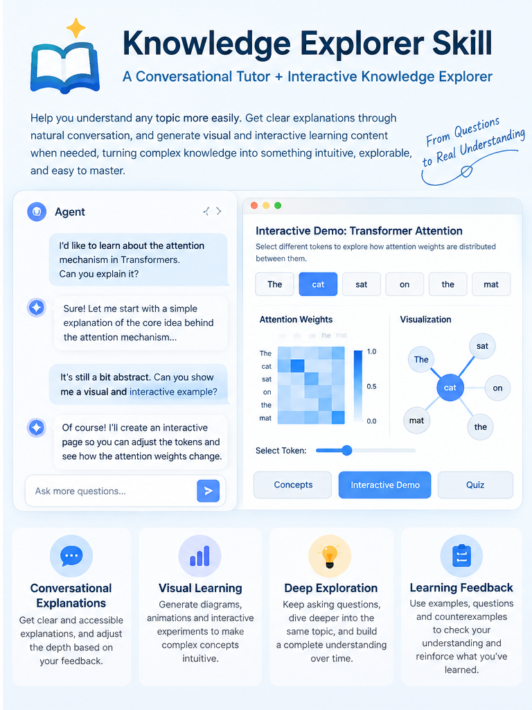

# Knowledge Explorer Skill



> Learn through conversation, then explore difficult ideas with visual and interactive tools created by your agent when you need them.

[](LICENSE)   

**Knowledge Explorer Skill** is an open-source learning skill for everyday AI agent users. Ask a question or provide an article, paper, or document. Your agent helps explain the material and, when useful, can create diagrams, step-by-step demonstrations, or interactive HTML learning experiences.

It combines a **conversational knowledge tutor** with an **interactive knowledge explorer**: understand the idea, experiment with it, and keep asking questions.

🌐 Language: **English** · [简体中文](README.md)

## What can it do?

- **Learn by asking:** Understand concepts, technical mechanisms, research methods, and key ideas in papers.
- **Make abstract ideas tangible:** Use concept maps, process diagrams, comparisons, animations, or interactive examples when suitable.
- **Explore actively:** Adjust parameters or step through a process when there is a meaningful model to explore.
- **Keep the conversation going:** Ask follow-up questions about the same example or request changes to an existing learning page.
- **Check understanding:** Use concrete examples, counterexamples, or short questions to reinforce learning.

> The skill does not create a webpage for every question. Straightforward topics are explained directly; richer visualization is used only when it helps.

## Examples

**Understand a concept**

```text
Use Knowledge Explorer to explain RAG with a simple everyday example.
```

**Explore a complex mechanism**

```text
Help me understand backpropagation with an interactive demo.
Let me adjust the learning rate and see what changes.
```

**Read a paper**

```text
Use Knowledge Explorer to help me understand this research paper.
Start with the research question and key findings, then walk me through the methods.
```

**Keep learning**

```text
I still don't get the second step. Explain it differently,
and update the interactive demo if that would help.
```

## How it works

1. **Clarify the learning goal.** Focus on what you want to understand right now.
2. **Explain the essentials.** Start with accessible language and examples, then go deeper when needed.
3. **Choose the right representation.** Use text, diagrams, comparisons, step-by-step views, or an interactive page based on the subject.
4. **Support follow-up exploration.** Continue the conversation, modify demonstrations, and check understanding when useful.

When the host agent can create files and execute code, it may deliver a **single-file HTML learning page that works offline**. File reading, generation, and testing depend on the capabilities and permissions of your agent environment.

## Installation

This repository follows the [Agent Skills open specification](https://agentskills.io/specification). Install the **entire repository**, keeping `SKILL.md`, `references/`, and `assets/` in their original relative locations.

### Codex

```bash
git clone https://github.com/nightboy87/knowledge-explorer-skill.git ~/.codex/skills/knowledge-explorer
```

### Claude Code

```bash
git clone https://github.com/nightboy87/knowledge-explorer-skill.git ~/.claude/skills/knowledge-explorer
```

### Other compatible agents

Place the repository in your agent's Skills directory. Make sure the agent can discover `SKILL.md` and access the referenced files. Installation locations and execution permissions vary by host.

On Windows, use Git for Windows or download and extract the repository ZIP into the appropriate Skills directory.

## Repository structure

```text
knowledge-explorer-skill/
├── SKILL.md
├── README.md
├── README.en.md
├── LICENSE
├── references/
│   ├── teaching-guidelines.md
│   └── visualization-guidelines.md
└── assets/
    ├── html-template.html
    ├── readme-hero-zh.png
    └── readme-hero-en.png
```

- `SKILL.md`: Entry point, activation guidance, and core teaching behavior.
- `references/teaching-guidelines.md`: Explanations, examples, follow-up teaching, and feedback.
- `references/visualization-guidelines.md`: Choosing useful views and ensuring interactive examples behave honestly.
- `assets/html-template.html`: An offline-capable starting template containing **demonstration content**. Agents must replace irrelevant examples before delivering topic-specific pages.

## Limitations

- **Not a standalone app.** The skill runs inside your agent; it has no built-in chat service, accounts, or long-term learner history.
- **HTML is optional.** Simple explanations and diagrams are often enough.
- **No fake simulations.** Adjustable numerical demonstrations should follow a real defined model; conceptual illustrations must be labeled as such.
- **Grounded in the material.** Important claims and numbers should retain their conditions and sources; missing content must not be invented.
- **Host-dependent capabilities.** Reading PDFs, writing files, and running browser tests require appropriate host tools and permissions.

## Current status

**v0.1.1 — early release.** Includes core Skill instructions, teaching and visualization guidelines, and a runnable HTML template with demonstration data. Cross-agent end-to-end compatibility has not yet been established.

Questions and suggestions are welcome via [Issues](https://github.com/nightboy87/knowledge-explorer-skill/issues).

## License

Released under the [MIT License](LICENSE).
